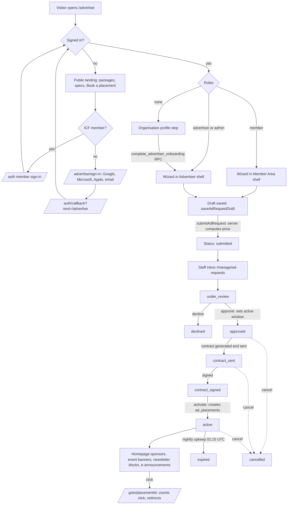

# Advertise with us

The Switzerland Chapter of ICF curates and approves advertising; it is not sold
self-service. Advertisers configure a request, staff review it, a contract is
signed, and only then do placements go live. Every price is computed on the
server from the active rate card.

> Status: implemented in the `Advertise-with-us-MVP` draft. The schema lives in
> two staged migrations (`20260824190000_advertise_with_us.sql`,
> `20261014150000_external_advertisers.sql`) and only exists once the draft is
> accepted. Until then `/advertise` shows a "not available yet" message.
> Sign-in providers (Google, Microsoft, Apple, email) must be enabled from the
> main project after acceptance.

## Who can book

| Account                     | How they get access                                                                      | Frame on `/advertise` | Price tier                     |
| --------------------------- | ---------------------------------------------------------------------------------------- | --------------------- | ------------------------------ |
| ICF member (synced)         | `member` role via the claim flow                                                         | Member Area shell     | Derived from member record     |
| External advertiser         | Sign in at `/advertise/sign-in`, then the profile step grants `advertiser`               | Advertiser shell      | Non-member (`icf_global`) tier |
| Platform admin              | Existing role                                                                            | Advertiser shell      | —                              |
| Signed in, no role          | Shown the organisation profile step                                                      | Advertiser shell      | —                              |

External advertisers are never rows in `members`; they have an
`advertiser_profiles` row and never reach Member Area pages (the `_member` gate
redirects them). Details: [advertising-external-advertisers.md](./advertising-external-advertisers.md).

## End-to-end flow

## Offers and pricing

- **Offer types** (`src/lib/ads.ts`): `partner_package` (gold / silver / bronze,
  12 or 6 months), `eannouncement` (visible 14 days after the announcement
  date), and `school` placements (`square_advert`, `newsletter`,
  `event_banner`, each with its own durations).
- **Rate card** (`ad_rate_cards`): versioned; one is active. Staff edit it at
  the rate card screen. Prices are never hardcoded in code.
- **Price** (`src/lib/ads-pricing.ts` `computePrice`): pure function. The
  wizard calls it for a preview; the stored `computed_price` always comes from
  the server calling the same function.
- **Eligibility** (`src/lib/ads-eligibility.server.ts`): e-announcement tier is
  derived from the member's membership and credential, never chosen. Without a
  member record (external advertisers, unknown credential) it falls back to the
  higher `icf_global` tier. Staff may override at review
  (`eligibility_source = staff_override`).

## Data model

| Table               | Purpose                                                                                       |
| ------------------- | --------------------------------------------------------------------------------------------- |
| `ad_rate_cards`     | Versioned prices; active card readable by signed-in users, managed by administrators.        |
| `ad_requests`       | One booking request: selection, status, price, eligibility, `requester_kind` (`member`/`external`). |
| `ad_request_events` | Audit log of every status transition.                                                         |
| `ad_contracts`      | Printable contract per approved request.                                                      |
| `ad_placements`     | Live slots; public can read active ones.                                                      |
| `advertiser_profiles` | Organisation, contact, billing address, VAT for external advertisers.                       |

Safeguards:

- `tg_ads_transition_guard` trigger: a non-staff user can only insert a
  `draft` with price 0, and can never change status, price, eligibility or
  review fields. Only staff and the service role move a request forward.
- A restrictive insert policy requires `member` or `advertiser` on
  `ad_requests`.
- `ad_placement_click` RPC counts clicks for `/goto/$placementId`.
- Legal transitions are enforced in `transitionRequest` (`LEGAL_FROM`) and
  logged to `ad_request_events`.

## Code map

| Area                 | Location                                                                                     |
| -------------------- | -------------------------------------------------------------------------------------------- |
| Route                | `src/routes/advertise.tsx` (role-adaptive), `src/routes/advertise_.sign-in.tsx`              |
| UI                   | `src/components/member/AdvertiseWizard.tsx`, `src/components/advertiser/*`                   |
| Booking functions    | `src/lib/ads.functions.ts` (catalogue, drafts, submit, logo upload, active placements)       |
| Onboarding functions | `src/lib/advertisers.functions.ts` (rate-limited)                                            |
| Server logic         | `src/lib/ads.server.ts` (rate card, submit, transitions, contracts, placements)              |
| Staff functions      | `src/lib/ads-admin.functions.ts`; screens under `src/routes/_staff/manage.ad-requests*`      |
| Nightly expiry       | `src/routes/api/public/ad-upkeep.ts` → `src/lib/ads-upkeep.server.ts` (cron token auth)     |
| Emails               | `src/lib/email-templates/ad-placement-live.tsx`, `ad-placement-expiring.tsx`                 |
| Roles                | `src/lib/role-model.ts` (`advertiser`, `landingPath` → `/advertise`)                         |

## Open items

- Enable Google, Microsoft, Apple and email sign-in after acceptance.
- Confirm rate card v1 figures against approved chapter pricing.
- Staff verification of external organisations and invoicing details.

## Rate card price guard

A published rate card stays in force for three months. Earlier changes are only accepted as an error correction with a reason (10+ characters); it is stored as a new version with note "Correction: …", so history is never overwritten. Publishing deactivates the current card before inserting the new one (single-active index). The history table on /manage/ad-rate-cards lists every version.

## Booking wizard (five steps)

1. Offer, 2. Configuration (package/placements, duration, start date).
3. **Content** — link, image and logo (two separate uploads; uploading the same file twice is rejected client-side by SHA-256), headline + text per language (DE/FR/IT/EN) with an AI "translate to the other languages" action (`translateAdCopy`, rate-limited, authenticated). A live preview shows the banner, square and newsletter formats that apply to the booking. The newsletter-mentions question is gone; mentions are scheduled by staff per package.
4. **Advertiser and contract** — organisation, contact name, email, phone, billing address, VAT. Prefilled by `getAdvertiserPrefill` from the caller's advertiser profile, else their linked member record (`auth_user_id`, never email). Editable per request.
5. **Summary** — offer/price, content previews and contract details, each with an Edit link.

`submitAdRequest` rejects drafts missing contract fields (`missingContractFields` in `src/lib/ads.ts`). New columns on `ad_requests`: `image_path`, `headline_*`, `contact_name`, `contact_phone`, `billing_*`, `vat_number`; activation copies `image_path` and `headline_*` to `ad_placements`. Public rendering of banner/square ads is still not built.

## Ad styles

Advertisers pick one of three styles in the Content step: **Editorial** (default, white card), **Spotlight** (Deep Blue band, on-dark button, Yellow "Sponsored" label) and **Warm split** (bone surface, rounded image, brush underline, outlined pill). The choice is stored as `ad_requests.design_variant` (`editorial` | `spotlight` | `warm`, check-constrained) and copied to `ad_placements.design_variant` on activation, so public renderers can draw the same style. `AdPreview` renders all nine format × style combinations; unknown values fall back to Editorial (`resolveAdDesignVariant`).
